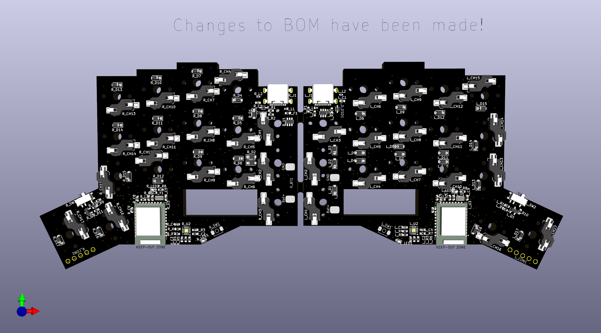
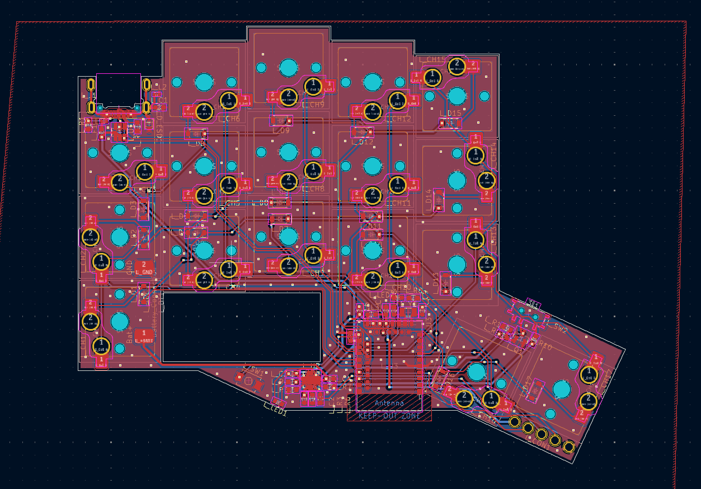
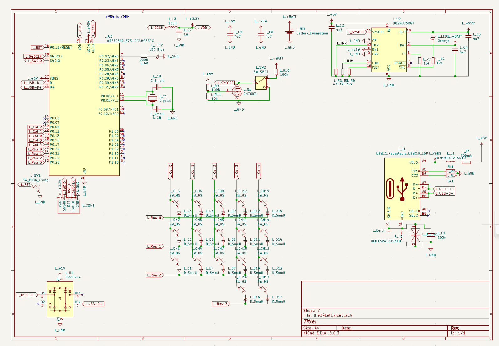
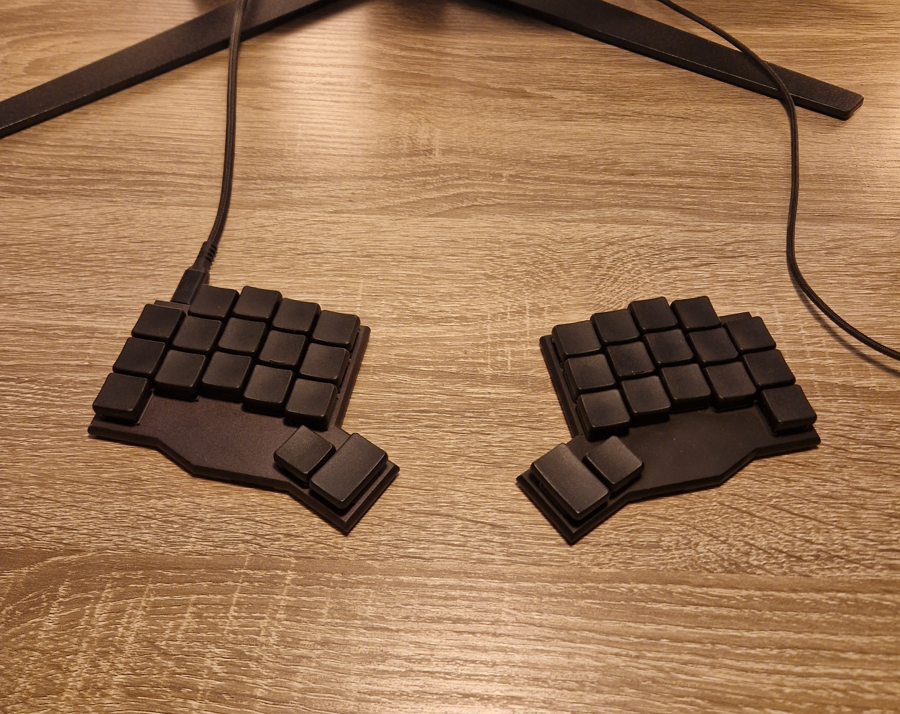

# Ble34-bluetooth-keyboard
Files from the Ble34 project

Custom PCB for a wireless keyboard using running ZMK on nRF52840.

Flashed using picoprobe as debugger.

The final keyboard has a slick case in mate black and can be used both wired and not. 

